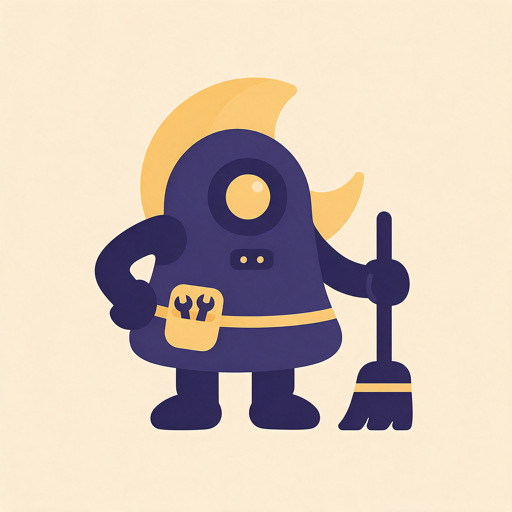

# bau — Overnight BAU maintenance worker: Plane items in, pull requests out



## Support

If you find this useful, please consider buying me a coffee:

[](https://www.paypal.com/donate?hosted_button_id=Q3BESC73EWVNN&custom=bau)

## Table of Contents

<!-- toc -->

- [What it is](#what-it-is)
- [How it runs](#how-it-runs)
- [Repository layout](#repository-layout)
- [Install on Cere](#install-on-cere)
- [Development](#development)
- [Architecture Diagram](#architecture-diagram)
- [Architecture Diagrams](#architecture-diagrams)
- [Support](#support)

<!-- tocstop -->

## What it is

BAU ("business as usual") is a nightly worker that runs on Cere, picks up Plane work items
labelled `BAU`, works each one in a disposable Linux container, raises one pull request per
item, and never merges or deploys. Martin reviews the PRs when he gets round to it, from
`bau.home.nakomis.com`, and BD-1 shows how many are waiting.

The design is in `docs/superpowers/specs/2026-10-14-bau-design.md`; the implementation plans
are in `docs/superpowers/plans/`.

## How it runs

Three launchd jobs on Cere, all as the `nakomis` user:

- `com.nakomis.bau-run` at 01:00 every night: the worker itself. Each night it also sweeps for BAU candidates, triages them, and asks questions on unclear tickets.
- `com.nakomis.bau-snapshot` hourly during the day: refreshes `state.json` for the dashboard.
- `com.nakomis.bau-api` kept alive: serves the dashboard API.

Usage is bounded by a pace rule read from Claude Code's own rate-limit telemetry, a 05:00
cut-off, and per-session budget and wall-clock limits, so the worker never eats the week.

## Repository layout

| Path | Purpose |
|------|---------|
| `bau/` | Host-side Python: policy, Plane and GitHub clients, the nightly loop, the CLI |
| `container/` | The agent image and the egress allow-list proxy |
| `config/` | `host.example.yaml`, documenting the per-host overlay (policy is in `bau/defaults.yaml`, packaged in the wheel) |
| `scripts/` | `build-bundle.sh`, which builds the release bundle |
| `launchd/` | The scheduled job templates (`.plist.in`) |
| `web/` | The dashboard (Vite + React), served at `https://bau.home.nakomis.com/` once Cere is wired (HOME-445); see `docs/runbook.md` |
| `docs/` | Spec, plans, runbook, architecture diagram |

## Install on Cere

CI builds each release: a bundle (`bau-<version>.tar.gz`: wheel, hashed requirements, launchd templates, compose file) published as the GitHub release `bau-v<version>`, and two `linux/arm64` images pushed to `registry.home.nakomis.com`. Cere installs a pinned version through the home-servers Ansible play (BAU-25; `bau_version` in `cere/ansible`). See `docs/runbook.md` for the layout, keychain items, upgrade and rollback.

## Development

```bash
uv sync
cp config/host.example.yaml config/host.yaml   # gitignored; uncomment what you need
uv run bau --config config/ run --dry-run
uv run pytest
```

## Architecture Diagram


## Architecture Diagrams

`docs/architecture/bau.drawio` is the source for the diagram above.
The SVG is auto-regenerated on commit by the pre-commit hook in `.githooks/pre-commit`.

To activate the hook after cloning:

```bash
git config core.hooksPath .githooks
```

## Support

If you find this useful, please consider buying me a coffee:

[](https://www.paypal.com/donate?hosted_button_id=Q3BESC73EWVNN&custom=bau)
